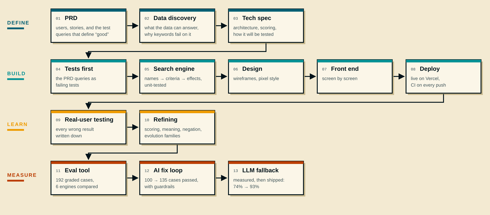

# Steps

How I built it: define what "good" means, build it test-first, learn from a real user, then measure everything.

| Phase | What I did | What came out |
| --- | --- | --- |
| **Define** | Wrote down who searches, for what, and how I'd know the search works; checked what the data can answer | A PRD with prioritised stories and test queries, a data discovery, a tech spec |
| **Build** | Turned the test queries into failing tests, then built the search to pass them, then the app | A tested search engine, the app, live on Vercel |
| **Learn** | Watched a real user search and wrote down every wrong result | Fixes to scoring, meaning, negation and evolution families |
| **Measure** | Graded 192 queries across 6 engines, let an AI fix failures inside guardrails, then tested an LLM | 74% without AI, 93% with an LLM fallback |

## The documents

| # | Document | In one line |
| --- | --- | --- |
| 1 | [Product requirements](./01-prd.md) | The problem, the users, and what the search must do |
| 2 | [Data discovery](./02-data-discovery.md) | What the dataset can and can't answer, and why keyword search fails on it |
| 3 | [Tech spec](./03-tech-spec.md) | How the search works, as built, and what changed from the plan |
| 4 | [Design spec](./04-design-spec.md) | What each screen shows and how it behaves |
| 5 | [Evaluation](./05-evaluation.md) | How good the search is, in numbers, and whether an LLM is worth adding |
| 6 | [Write-up](./06-write-up.md) | Choices, limitations, what I'd do differently, next steps |

Live app: https://prof-chen.vercel.app/ · Live evaluation: https://prof-chen.vercel.app/eval
