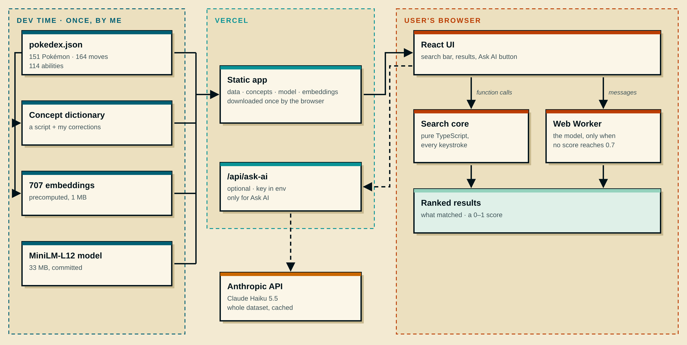
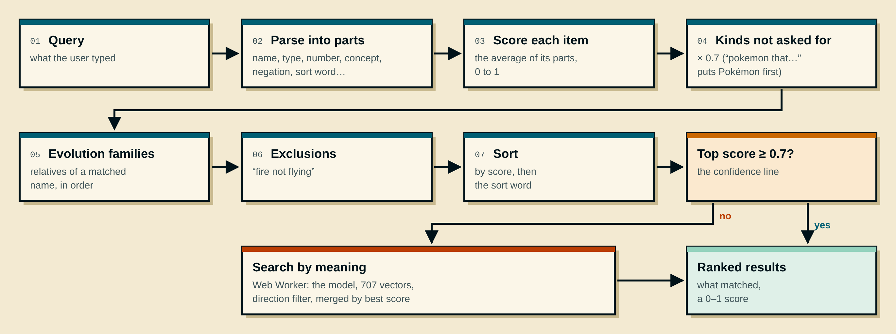
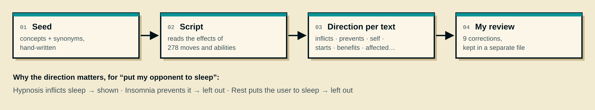
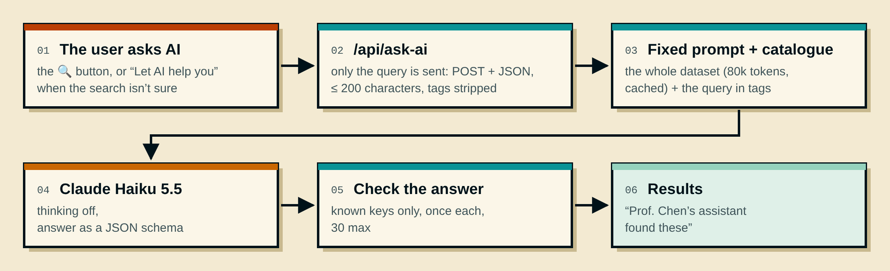

# Tech Spec — Pokédex Search

## Contents

- [1. Overview](#1-overview)
- [2. Stack](#2-stack)
- [3. Architecture](#3-architecture)
- [4. Data](#4-data)
- [5. Search](#5-search)
- [6. LLM search](#6-llm-search)
- [7. Quality](#7-quality)
- [8. What changed from the initial plan](#8-what-changed-from-the-initial-plan)
- [9. 🤖 How I used AI for this document](#9--how-i-used-ai-for-this-document)

## 1. Overview

- **The search runs in the browser:** free, offline once loaded, no key.
- **Deterministic first**, **meaning as a fallback** (a small local model), **an LLM as an option** (a button, on a server route).
- **Every result has a score from 0 to 1** and shows what matched.

## 2. Stack

| Need              | Choice                                                            | Why                                                        |
| ----------------- | ----------------------------------------------------------------- | ---------------------------------------------------------- |
| Language          | TypeScript, strict                                                | Types catch the data's edge cases                          |
| Front end         | React + Vite                                                      | Nothing needs server rendering                             |
| Styling           | SCSS + BEM                                                        | Type colours and spacing as variables                      |
| Search by meaning | Transformers.js, all-MiniLM-L12-v2 (8-bit, 33 MB)                 | Runs in the browser; measured against 4 other small models |
| Optional AI       | One Vercel serverless function → Anthropic API (Claude Haiku 5.5) | Keeps the key on the server                                |
| Tests             | Vitest, Playwright                                                | Unit + end-to-end                                          |
| CI / hosting      | GitHub Actions, Vercel                                            | Every push tested; preview per branch                      |

## 3. Architecture

*Dashed: optional, only when the user asks AI.*

- **The search core is pure TypeScript**, no UI dependency, so it was tested before any UI existed.
- **The model runs in a Web Worker**, so typing never waits.
- **The server route only exists for Ask AI.** Without a key, the app is fully static.

## 4. Data

- **Index built at start** (a few ms): names normalised (lowercase, no accents, hyphens → spaces), Pokémon ↔ moves ↔ abilities linked both ways, evolution families grouped.
- **Data checks as tests:** counts (151 / 164 / 114), no empty effects, every referenced move and ability exists.
- **Source:** the dataset provided with the exercise, credited in the README.

## 5. Search

### 5.1 The pipeline

### 5.2 What the parser recognises

| Part | Examples |
| --- | --- |
| Name, with typos | "bulba", "pikachoo", "mr mime" |
| Type | "electric", "fire" |
| Descriptor | "green", "cave", "quadruped", "Mouse Pokémon" |
| Number and unit | "speed over 150", "90kg" |
| Concept (an effect) | "sleep", "burn", "rain" |
| Sort word | "fast", "strongest", "heavy" |
| Kind word | "pokemon that…", "move", "ability", "who" |
| Family word | "evolution of pikachu" (both directions) |
| Negation | "not", "no", "without", "except" |
| Pokémon GO syntax | `@surf` (learns), `!fire` (not), `&` (and) |
| Filler | "the", "a", "what", question words |
| Unknown | left to the search by meaning |

### 5.3 Scores

**An item's score = the average of its scores on each part of the query** (or its name score on the whole query, when that's higher: "mr mime").

| Match | Score | Why |
| --- | --- | --- |
| Exact name, type, number met | 1 | Only literal matches score 1, so "exact match" means something |
| Start of a name | 0.7 + 0.3 × how much of the name it covers | A name start is a confident match; the more of the name typed, the higher |
| Inside a name (3+ letters) | 0.5 + 0.3 × how much it covers | Weaker than a start ("saur" in Bulbasaur); 3 letters minimum so "in" doesn't match Insomnia |
| Start of a type or descriptor (4+ letters) | 0.95 | "elec" clearly means Electric, but it isn't literal |
| Typo | 1 − changes ÷ length; at most 40% of the name's letters, rounded down | One change in a long name barely costs; 40% came from a real user's "blaaastoiise" |
| Concept stated in the effect | 0.85 | Matched through the dictionary, not literally, so below 1 |
| Concept as a chance ("has a chance to burn") | 0.75 | A chance to burn ranks below a move that burns |
| Concept copied ("copies the target's…") | 0.72 | Indirect: it passes a condition on rather than causing it |
| Typed word in the name ("Sleep Powder" for "sleep") | + 0.05 | The user's own word in the name |
| Pokémon brought in by a move or ability | × 0.9, + 0.02 per extra one (up to 3) | One step away from the effect; several matching moves make it more relevant |
| Kind not asked for ("pokemon that…" → moves) | × 0.7 | Pokémon come first, but moves stay visible |
| Search by meaning | Cosine rescaled to 0–1, capped at 0.95 | Meaning alone is never an exact match |

- **0.7 is the confidence line:** below it, the search by meaning runs, and the app suggests Ask AI.
- **These values are ranking rules I set, then checked on the eval.** None was tuned to make a specific query pass.

### 5.4 Concept dictionary

- **Concepts:** status conditions (sleep, paralysis, poison, burn, freeze, confusion, flinch) and weather (rain, sun, sandstorm, hail).
- **The direction matters:** Hypnosis *inflicts* sleep, Insomnia *prevents* it, Rest is *self*. "Put my opponent to sleep" returns only the first kind.
- **Every tag keeps its sentence as evidence.** My 9 corrections are kept in a separate file (`corrections.ts`), so the dictionary = script output + visible human corrections.

### 5.5 Search by meaning

|                 |                                                                                                     |
| --------------- | --------------------------------------------------------------------------------------------------- |
| Model           | all-MiniLM-L12-v2, 8-bit, 33 MB, in the repo                                                        |
| Texts           | 707 (move and ability effects, Pokémon descriptions), embedded at dev time                          |
| When            | Only when no result scores 0.7 or more                                                              |
| Scoring         | Cosine 0.3 → 0, 0.7 → 0.95 (never 1: never an exact match); below 0.24, hidden; descriptions × 0.85 |
| Why L12, not L6 | L6 couldn't separate "doze off" from "spaghetti"; L12 put the sleep moves 1st–5th                   |

### 5.6 Example

| Query | What happens |
| --- | --- |
| put my opponent to sleep | "sleep" is a concept → moves that *inflict* sleep (Sing, Hypnosis, Spore…) → their Pokémon. Insomnia and Rest left out. No model needed |
| make the enemy doze off | "doze" is a sleep word, but "off" matches nothing → the average is about 0.43, below 0.7 → search by meaning → the same sleep moves, ranked by similarity |

## 6. LLM Search

| Concern             | How it's handled                                                                                                                                                                                                   |
| ------------------- | ------------------------------------------------------------------------------------------------------------------------------------------------------------------------------------------------------------------ |
| The key             | Server env only, never `VITE_`, never logged or returned                                                                                                                                                           |
| Prompt injection    | Fixed prompt, query as data in its own tags, no tools, no secrets in the prompt, answer checked against the catalogue (unknown keys and markup dropped)                                                            |
| What it sends       | The whole dataset (80k tokens, cached), minus image URLs and duplicated reverse lists                                                                                                                              |
| What it returns     | Up to 30 keys, best first, as structured output (a JSON schema); no notes, so it's faster                                                                                                                          |
| Model               | Claude Haiku 5.5, thinking off by default (`AI_THINKING=enabled` turns it on); one file (`api/_lib/models.ts`) holds each model's id, prices and thinking setting                                                  |
| Cost                | ~0.82 € per 1,000 queries with the cache warm, up to ~10 € with sparse traffic; capped in the Anthropic console                                                                                                    |
| When it's suggested | When no deterministic result reaches 0.7, once the search by meaning has settled, if the server has a key and the AI wasn't already asked: "Not what you're looking for? Let AI help you". Never called on its own |
| No key              | Button and suggestion hidden, the rest unchanged                                                                                                                                                                   |

## 7. Quality

| Check                         | Tool                                                     | Runs                                              |
| ----------------------------- | -------------------------------------------------------- | ------------------------------------------------- |
| Lint, types, styles, format   | ESLint, TypeScript, Stylelint, Prettier                  | Every push                                        |
| Unit tests                    | Vitest                                                   | Every push                                        |
| The PRD's queries             | Vitest                                                   | Every push                                        |
| Search by meaning, real model | Vitest                                                   | Every push (a CI step; the model is in the repo)  |
| End-to-end                    | Playwright                                               | Every push; on the live site by hand (`BASE_URL`) |
| Key leak check                | Script on the build and tracked files (the api key prefix) | Every push                                        |
| Evaluation                    | `npm run eval`, `/eval`                                  | On demand, see [Evaluation](./05-evaluation.md)   |

## 8. What changed from the initial plan

| Planned                             | As built                                            | Why                                                                                                   |
| ----------------------------------- | --------------------------------------------------- | ----------------------------------------------------------------------------------------------------- |
| all-MiniLM-L6-v2                    | **L12**                                             | Measured: L6 couldn't separate meaning from noise                                                     |
| Embeddings computed in the browser  | **Precomputed at dev time**                         | Faster first visit, simpler tests                                                                     |
| Concepts score 1                    | **0.85 / 0.75 / 0.72**                              | Ranking: a stated effect beats a chance of it                                                         |
| Typos: 30% of letters               | **40%, + start-of-name match**                      | A real user's "blaaastoiise" (3 changes in 9 letters) failed at 30% (2 allowed) and passes at 40% (3) |
| No exclusion                        | **Negation + Pokémon GO syntax**                    | Real-user searches                                                                                    |
| No server                           | **One optional server route**                       | The LLM needs a key kept off the browser                                                              |
| LLM: a compact catalogue with notes | **The whole dataset, keys only, structured output** | Measured: v1 147 → v3 153; notes cost time, and thinking cut answers at the token cap                 |
| —                                   | **Evolution families, units, kind words**           | Real-user searches                                                                                    |
| —                                   | **An eval with 6 engines**                          | Pass/fail hid ranking (Sleep Powder was 33rd)                                                         |

## 9. 🤖 How I used AI for this document

- **Organising my ideas.** I described how I imagined the solution: search in the browser with a small local model, a concept dictionary generated by a script, the typo rule, tests and CI before code. Claude organised them into this document.
- **Choosing the model.** It helped me pick a small embedding model that runs in the browser. Once the tests ran, Claude Code compared 5 small models on the same probes: all-MiniLM-L6-v2 couldn't separate "make the enemy doze off" from "spaghetti", so I switched to L12 from the numbers.
- **Diagrams.** It drew the architecture and search-flow diagrams from my descriptions; I asked for changes until they matched how I see the system.
- **Testing an idea before committing to it.** I wasn't convinced a script could build the concept dictionary, so I had it prototype one on the real dataset. Seeing what it got right and wrong convinced me, and its mistakes became test cases.
- **Keeping this document true.** After the build, I had Claude Code fact-check it against the code, with a file and line for each statement; every mismatch was fixed.
- **Where I changed its direction:**
  - It first recommended Next.js, to keep an API key on a server. I chose to run the search in the browser and picked Vite. The one server route came later, only for the optional AI.
  - It proposed scoring a result by its highest signal. I pointed out that gives almost only 0 or 1, which led to the average-over-parts definition.
  - It suggested capping semantic scores at 0.80; I kept 0.95, so a strong meaning match can still lead.
  - It proposed shipping pre-computed embeddings; I first chose to compute them in the browser, then reversed it when it measured a faster first visit and simpler tests.
  - I found its first draft repetitive and too close to the code, and had it rewritten so every fact lives in one place. Later it rewrote this spec without being asked; I reverted it.

---

**Previous:** [Data discovery](./02-data-discovery.md) · **Next:** [Design spec](./04-design-spec.md) · [All steps](./00-steps.md)
