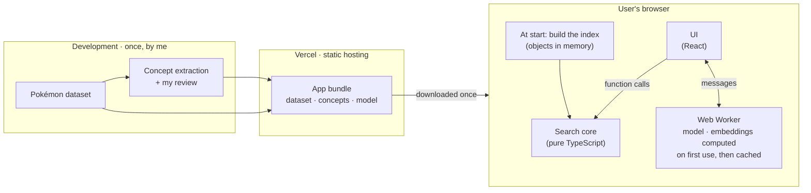
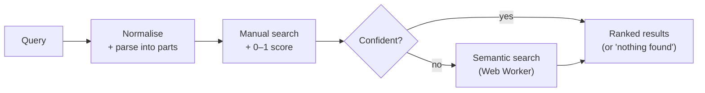

# Tech Spec — Pokédex Search

## Contents

- [1. Overview](#1-overview)
- [2. Stack](#2-stack)
- [3. Architecture](#3-architecture)
- [4. Data](#4-data)
- [5. Search](#5-search)
- [6. Quality](#6-quality)
- [7. Risks](#7-risks)
- [8. 🤖 How I used AI for this document](#8--how-i-used-ai-for-this-document)

## 1. Overview

- A React app where **all search runs in the browser**: no server, no API key, no paid service.
- **Manual search first** (names, criteria, concepts); **semantic search** with a small in-browser model when manual search isn't confident.
- Every result gets a **match score from 0 to 1**; results are ranked by it.

## 2. Stack

- **Language:** TypeScript.
- **Front end:** React, built with Vite. Everything runs in the browser, so there's no need for a server framework.
- **Routing:** React Router.
- **Styling:** SCSS. Variables and mixins keep type colours and spacing consistent.
- **Semantic search:** Transformers.js with all-MiniLM-L6-v2, a small English sentence model that runs in the browser.
- **Unit tests:** Vitest.
- **End-to-end tests:** Playwright. Thunders for recorded checks on production.
- **CI/CD:** GitHub Actions.
- **Hosting:** Vercel.

## 3. Architecture

**There is no back end.** The dataset is small (151 Pokémon, 164 moves, 114 abilities) and there's no secret to protect, so the app is a set of static files and every search runs in the user's browser. Only the concept dictionary is prepared ahead of time, because it needs my review.

- **Development → app: prepared data only.** The app works offline once loaded, and the browser never does heavy work on the main thread.
- **UI → search core: plain function calls.** The core has no UI dependency, so it's tested before any UI exists.
- **UI ↔ semantic search: messages to a Web Worker.** The model never blocks typing, and it can be loaded late or swapped without touching the rest.

## 4. Data

- **Index built at start:** the app loads the dataset and builds typed objects in memory (a few milliseconds): names normalised (lowercase, accents removed, hyphens to spaces), Pokémon ↔ moves ↔ abilities linked both ways (built from the Pokémon side; the dataset's reverse lists are identical), evolution families grouped by chain and ordered by Pokédex number (Eevee's, the only branching family here, shown as a branch).
- **Data checks as tests:** expected counts (151 / 164 / 114), no empty effect texts, every move and ability named on a Pokémon exists. If the dataset ever changes, these fail first.
- **Source:** a fixed copy of the dataset provided with the exercise, credited in the README.

## 5. Search

### 5.1 Flow

Three layers, each for the job it does best: **manual matching** for names, types and numbers; a **concept dictionary** for effects like sleep or rain (keyword search gives wrong answers on this data, see [data discovery](./02-data-discovery.md)); **semantic search** for phrasings nothing else recognises (embeddings are good at meaning, bad at names and typos).

Manual search runs on every keystroke (about a millisecond over 151 Pokémon). Semantic search runs only when manual search isn't confident, debounced.

### 5.2 Parsing and matching

The normalised query is split into **parts**; each part is matched by its kind.

| Kind | Examples | Matching |
| --- | --- | --- |
| Name | "bulba", "saur", "pikachoo" | Exact, start of the name, anywhere in it (3+ letters), or typo (see below) |
| Type | "electric" | The 18 types in the data, typo-tolerant |
| Descriptor | "green", "cave", "fish" | The colours, habitats and shapes in the data (e.g. users who only remember a Pokémon was green) |
| Number | "speed over 150" | Stat name + comparison |
| Concept | "sleep", "rain" | Concept dictionary (5.4) → the moves and abilities that **inflict** it, then the Pokémon that have them |
| Sort word | "fast", "strong" | Sets the order only: fast → speed · slow → speed ascending · strong → attack · strongest → total stats · heavy → weight · tall → height · tanky → hp + defense |
| Unknown | "spaghetti", "doze off" | Left to semantic search |

- **Typos (fuzzy matching):** at most **30% of the matched word's letters** can be wrong (a swap of two letters counts as one change). Short words therefore need an exact match: 3 letters → 0 changes, 4–6 → 1, 7–9 → 2. "pikachoo" → Pikachu (2 / 7 = 29%) passes; "pikachooo" doesn't.
- **Relationships:** a matched move or ability brings in the Pokémon that learn or have it, which keep *what* matched (shown on the result, [PRD M5](./01-prd.md#m5-show-what-matched)).
- **Themes** ([PRD M4](./01-prd.md#m4-theme-search-across-categories-challenge-4)): results grouped by kind (abilities, moves, Pokémon). Gaps in the data aren't detected ([PRD limits](./01-prd.md#8-limits)).

### 5.3 Scoring

**Score of a result = the average, over the parts of the query, of how well the result meets each part.** This grades near misses (useful for ranking) and gives 0 to unrelated queries.

| Part | Score |
| --- | --- |
| Name | Exact = 1 · start of the name > anywhere in it, both higher when they cover more of the name · typo = 1 − (changes ÷ length), so ≥ 0.7 |
| Type, ability, move, descriptor | 1 or 0 |
| Number | 1 if met, otherwise how close (150 for "over 150" ≈ 0.95) |
| Concept | 1 if the item inflicts it |
| Unknown | Semantic similarity, rescaled to 0–1 |

- Exact matches (every part = 1) are highlighted ([PRD M6](./01-prd.md#m6-ranked-by-how-well-it-matches)). Sort words only order results with equal scores.
- **One global threshold:** below it, results are hidden ([PRD M7](./01-prd.md#m7-no-match-means-no-results)); if the best manual score is below it, semantic search runs. Its value, and every number above, is set with the [PRD's test queries](./01-prd.md#7-success-metrics) ("spaghetti" and "drain" below, "pikachoo" and "put my opponent to sleep" above).

### 5.4 Concept dictionary

Links the words a user types to the moves and abilities that do something with them, **and in which direction**. Built once during development:

1. **Seed (hand-written):** each concept with its word roots and the synonyms users might type, e.g. *sleep*: sleep, asleep · doze, nap. Concepts: status conditions (sleep, paralysis, poison, burn, freeze, confusion, flinch) and weather (rain, sun, sandstorm, hail).
2. **Script:** reads every effect sentence containing a root **as a whole word** (so "drains" never matches "rain") and tags its direction with ordered rules: *mentions* (ignored, e.g. "cannot be selected by Sleep Talk") · *prevents* ("cannot be asleep") · *self* ("User falls to sleep") · *affected by* / *benefits from* (weather) · *inflicts* ("Puts the target to sleep") · *unclear* otherwise. Each tag keeps its sentence as evidence. Generating it this way is reproducible, and much faster than reading 278 effect texts by hand.
3. **Review:** I check the unclear and suspicious tags; each correction is recorded separately, so the dictionary = script output + visible human corrections.

A prototype run on the dataset tagged most texts correctly and got a few wrong (Limber "cannot be paralyzed" as *inflicts*, Solar Beam as *benefits from* rain). Each such case becomes a unit test.

**Species descriptions** are lore, not mechanics (Snorlax "sleeps" but has no sleep move): they're used by semantic search only, ranked below moves and abilities.

### 5.5 Semantic search

- **Model:** all-MiniLM-L6-v2 to start. Once the test queries run, compared with bge-small-en-v1.5 on the same queries; switched only if clearly better. Model files ship with the app, so it works offline.
- **Embeddings** (a list of numbers representing a text's meaning; similar meanings give similar lists): the ~430 searchable texts (move and ability effects, species descriptions) are embedded **in the browser, in the background, right after the app starts**, then cached. Manual search works meanwhile; if a search needs meaning before they're ready, the UI says so. Computing them in the browser instead of shipping them means nothing generated to keep in sync, and swapping models is a setting.
- **Per query:** embed the query, compare it with the cached embeddings (cosine similarity: ~1 = same meaning, ~0 = unrelated), rescale to 0–1.

### 5.6 Example

**"put my opponent to sleep":** "sleep" is a concept, the other words are filler → the dictionary gives Sing, Sleep Powder, Hypnosis, Lovely Kiss, Spore and the ability Effect Spore, but not Insomnia (*prevents*) or Rest (*self*) → each brings in its Pokémon → score 1, no semantic search needed → results grouped by kind, e.g. "Jigglypuff · Sing · Puts the target to sleep."

**"make the enemy doze off":** "doze" isn't known → manual search isn't confident → semantic search finds the "Puts the target to sleep" texts → the same moves come back, ranked by similarity.

## 6. Quality

**Tests first:** the [PRD's test queries](./01-prd.md#7-success-metrics) are written as tests before the search exists.

| Check | Tool | Covers |
| --- | --- | --- |
| Lint + type check | ESLint, TypeScript | Code style and types |
| Unit tests | Vitest | Parsing, matching, the typo rule, scoring, concept tagging, data checks |
| Test queries | Vitest | The PRD's queries, end to end through the search core |
| Semantic search | Vitest | Our logic with a stand-in model (rescaling, threshold, when it runs); a few queries with the real model ("doze off" → sleep moves, "spaghetti" → nothing), also used to compare models and set the threshold |
| End-to-end | Playwright | One scenario per [Must story](./01-prd.md#must), plus an accessibility check |
| Production | Playwright, then Thunders | The same scenarios on the live site |

Everything runs in GitHub Actions on every push, except the production checks, which run after each deploy. The test queries report "X / N pass" and only block a merge once they've all passed (they're written before the code); the real-model tests run in a separate job, since the model download is slow. Vercel deploys production from `main`, with a preview for every push.

## 7. Risks

| Risk | Mitigation |
| --- | --- |
| First visit: loading the model (~20–25 MB) and embedding ~430 texts takes seconds, more on slow devices | Done in the background; manual search never waits; cached for later visits |
| Embeddings weak on short game texts | The concept dictionary covers the [PRD's test queries](./01-prd.md#7-success-metrics); measure before switching models |
| Global threshold too blunt | Tuned with the test queries; revisited after implementation |

## 8. 🤖 How I used AI for this document

- **Organising my ideas.** I described how I imagined the solution: search in the browser with a small local model, a concept dictionary generated by a script, the 30% typo rule, tests and CI before code. Claude organised them into this document.
- **Choosing the model.** It helped me pick a small embedding model that runs in the browser, and plan how to compare it with a bigger one once the tests run.
- **Diagrams.** It generated the architecture and search-flow diagrams (Mermaid) from my descriptions; I asked for changes until they matched how I see the system.
- **Testing an idea before committing to it.** I wasn't convinced a script could build the concept dictionary, so I had it prototype one on the real dataset. Seeing what it got right and wrong convinced me, and its mistakes became test cases.
- **Where I changed its direction:**
  - It first recommended Next.js, to keep an API key on a server. I chose to run the model in the browser, which removed that reason, and picked Vite.
  - It proposed scoring a result by its highest signal. I pointed out that gives almost only 0 or 1, which led to the average-over-parts definition.
  - It proposed shipping pre-computed embeddings. I chose to compute them in the browser and cache them.
  - I found its first draft repetitive and too close to the code, and had it rewritten so every fact lives in one place.

---

**Previous:** [Data discovery](./02-data-discovery.md) · **Next:** [Design spec](./04-design-spec.md) · [All steps](./00-steps.md)
