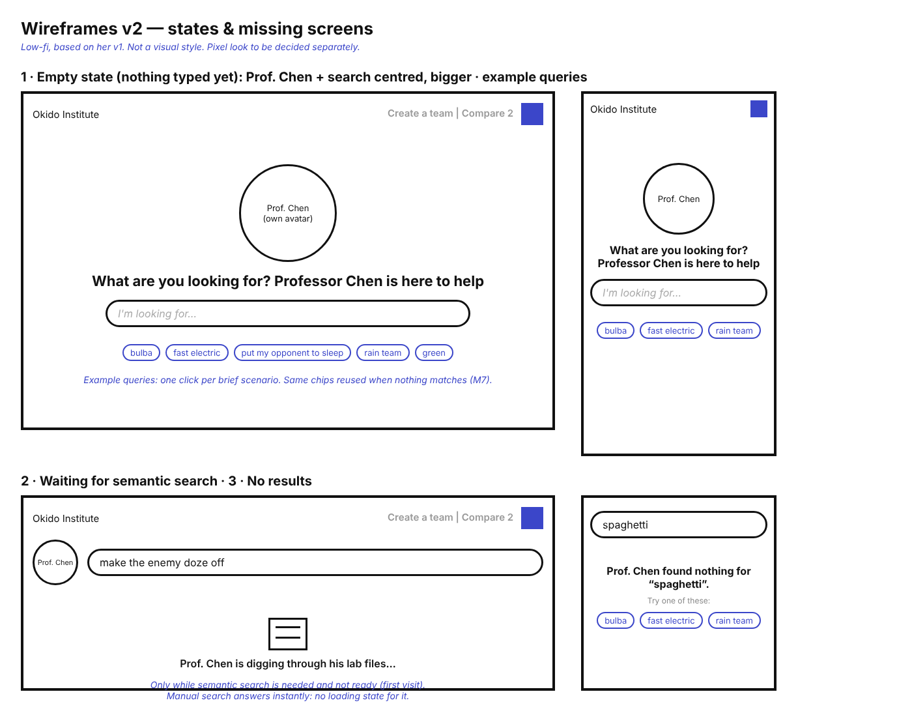
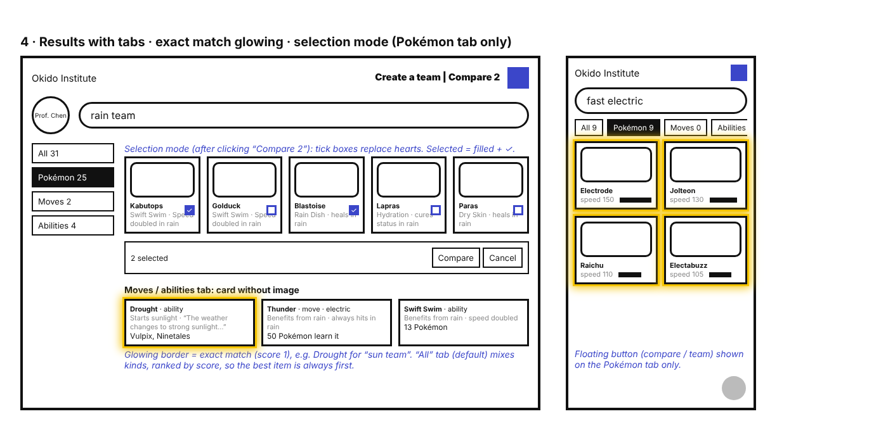
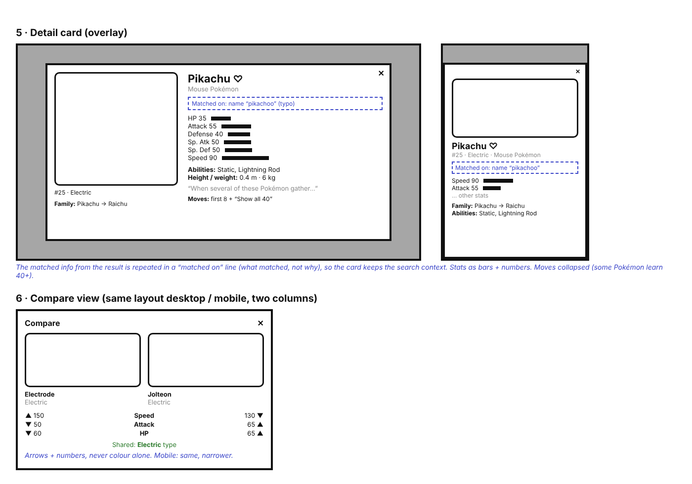
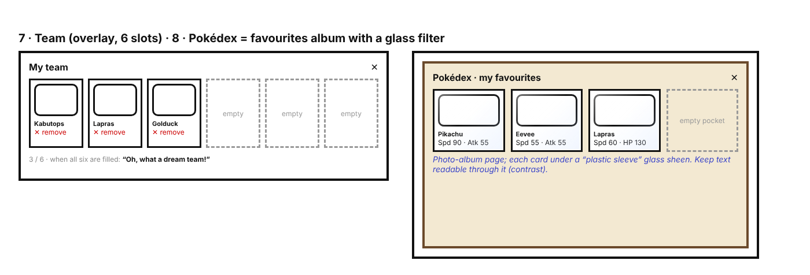

# Design Spec — Pokédex Search

## Contents

- [1. Principles](#1-principles)
- [2. Visual style](#2-visual-style)
- [3. Screens](#3-screens)
- [4. States](#4-states)
- [5. Interactions](#5-interactions)
- [6. Motion](#6-motion)
- [7. Desktop and mobile](#7-desktop-and-mobile)
- [8. Accessibility](#8-accessibility)
- [9. Scope](#9-scope)
- [10. 🤖 How I used AI for this document](#10--how-i-used-ai-for-this-document)

## 1. Principles

- **Search first.** The page is a search bar with a guide, Professor Chen. Everything else comes after a query.
- **Show what matched, not why.** Every result shows the information the user searched on: the speed for "fast electric", the move and its effect for "put my opponent to sleep", the ability for "rain team" ([PRD M5](./01-prd.md#m5-show-what-matched)).
- **The best result is always first.** One ranked list; exact matches stand out; close matches follow ([PRD M6](./01-prd.md#m6-ranked-by-how-well-it-matches)).
- **Never a dead end.** An empty page, a slow search or a missing image always says something useful and suggests what to do next.
- **Only show what works.** Buttons for features that aren't built yet are hidden, not disabled.

## 2. Visual style

A **pixel look**, matching the dataset: the original 151 Pokémon of the Game Boy era, whose sprites are pixel art.

### Typography

| Use | Font | Notes |
| --- | --- | --- |
| Headings, tab labels, buttons, Professor Chen's lines | **Press Start 2P** | Very wide and blocky: short text only, never sentences |
| Everything else (results, effects, stats, details) | **VT323** | A pixel font that stays readable in sentences; it renders small, so body text is **1.125 rem (18 px) minimum** |

Both are free (Google Fonts) and are **bundled with the app** rather than loaded from Google, so the app keeps working offline. Sizes come from one small scale; numbers line up in columns (VT323 is monospaced).

### Colour

Our own palette, defined once as variables (nothing copied from the Game Boy screen or the official Pokédex device). Base: [this palette](https://coolors.co/palette/001219-005f73-0a9396-94d2bd-e9d8a6-ee9b00-ca6702-bb3e03-ae2012-9b2226).

| Role | Colour | Used for |
| --- | --- | --- |
| Paper | `#E9D8A6` sand | Page background |
| Ink | `#001219` near-black | Text, pixel borders (13.5:1 on paper) |
| Accent | `#005F73` dark teal | Links, selected tab, tick boxes, focus ring (5.1:1 on paper) |
| Accent, light | `#0A9396` teal, `#94D2BD` mint | Hover, backgrounds of selected cards. **Never for text on paper** (too light) |
| Glow | `#EE9B00` amber | Exact-match border. Decoration only: never text on paper (1.6:1) |
| Danger | `#9B2226` dark red | Remove (5.6:1 on paper) |
| Warm accents | `#CA6702`, `#BB3E03`, `#AE2012` | Illustrations, the waiting animation, pixel details |

- **Type colours** are a separate set of 18 (the palette has no green, purple, pink or yellow, which Grass, Poison, Psychic and Electric need). They're used only as small badges, always with the type's name written on them, with ink or paper text chosen for contrast.
- All text meets **WCAG AA contrast** (4.5:1 for normal text).

### Shapes and details

- **Pixel borders and stepped corners** drawn in CSS (no images), reused through mixins.
- **Exact matches glow:** a bright border around the card.
- **Pokédex cards** get a **pixel shine**: a few white pixels in a corner, like light on a plastic sleeve.
- **Illustrations are our own:** Professor Chen's avatar and the icons (Pokédex, file drawer) are drawn for the app.
- **Spacing** in `rem`, from one scale (0.25 / 0.5 / 0.75 / 1 / 1.5 / 2 rem), so it follows the user's font-size setting.

## 3. Screens

Wireframes: [v1, hand-drawn](./design/wireframe-v1.png) and v2 below, generated from it.

### 3.1 Home

Header: the lab's name (Okido Institute) on the left; **Create a team · Compare 2** and the **Pokédex** icon (favourites) on the right.
Before anything is typed, Professor Chen and the search bar are **centred and large**: "What are you looking for? Professor Chen is here to help", with **example queries** under the bar, one per brief scenario (bulba · fast electric · put my opponent to sleep · rain team · green). Once the user types, Chen and the bar move to the top and results appear below.

### 3.2 Results

- **Tabs: All · Pokémon · Abilities · Moves**, each with its count. **All is the default**, mixing kinds ranked by score, so the best result is always first; the others narrow it down. Tabs rather than sections, because sections would push the best item of a lower section out of view.
- **Pokémon card:** image, name, **what matched** (e.g. "speed 150" with a bar, "Swift Swim · Speed doubled in rain"), and a heart to add it to the Pokédex.
- **Move or ability card:** no image; name, kind (and type for a move), what matched (e.g. "Benefits from rain · always hits in rain"), and how many Pokémon have it.
- **Exact matches** (score 1) glow; close matches follow in the same list, without the glow.

### 3.3 Detail card

An overlay on top of the results.
- **Desktop:** picture on the left; on the right the name and heart, the genus, a **"matched on"** line that keeps the search context ("Matched on: name 'pikachoo'"), stats as bars with their numbers, abilities, height and weight, the description, and the moves (the first few, then "show all").
- **Mobile:** picture on top, the same details below, most important first.
- **Evolution family:** in order (Pikachu → Raichu); Eevee's as a branch.

### 3.4 Browse and filter — designed, then dropped

Filters with include / exclude were designed for [PRD S3](./01-prd.md#s3-browse-and-filter--dropped) ([wireframe](./design/wireframe-v2-5-browse-and-filter.png)), then dropped after testing the built search: typing "electric", "green" or "fast fire" already narrows the results, and excluding a value fits better as negation in the search bar.

### 3.5 Selection mode (compare, team)

Clicking **Compare 2** or **Create a team** turns the Pokémon cards into selectable cards: a tick box replaces the heart, and a selected card shows a filled box **with a tick**. A bar at the bottom shows "2 selected" with the action and Cancel. **Only on the Pokémon tab:** on the other tabs, the desktop buttons are greyed out and the mobile button is hidden.

### 3.6 Compare

Two columns, the same on desktop and mobile (narrower): image, name and types on top; below, each stat on a line with both values and **▲ ▼ =**; shared types and abilities highlighted.

### 3.7 Team

A rectangular overlay with **six slots**: each filled slot shows the Pokémon's picture and name, with a way to remove it; empty slots stay visible. "3 / 6" shows progress; when all six are filled: **"Oh, what a dream team!"**

### 3.8 Pokédex (favourites)

An overlay that looks like a **photo album**: cards with picture, name and a couple of stats, each with the pixel shine. Empty pockets stay visible.

*(The wireframe shows an earlier glass effect; the pixel shine replaces it.)*

## 4. States

| State | What the user sees |
| --- | --- |
| Nothing typed | Home: Chen and the search bar centred, example queries |
| Waiting for semantic search (first visit only) | "Prof. Chen is digging through his lab files…" with an animated file drawer; manual results, if any, already shown. Manual search is instant, so it has no waiting state |
| No results | "Prof. Chen found nothing for 'spaghetti'." + the example queries |
| Semantic search unavailable | Manual results as usual, plus a short note that smart search couldn't load |
| Image fails to load | A placeholder in the image's place; name, types and what matched stay visible |
| Pokédex or team empty | The empty pockets / slots, with one line saying how to add a Pokémon |

## 5. Interactions

**Search**
- Results update **as you type**; manual search answers on every keystroke. Semantic search waits until typing pauses (~200 ms).
- **Enter** does nothing extra (results are already there); **Escape** in the search bar clears it and returns to the home state.
- Clicking an **example query** fills the bar and runs it.
- The query and the current tab are kept in the URL, so a search can be shared and survives a refresh.

**Results and cards**
- Changing tab keeps the query; counts update with every keystroke.
- Clicking a card (or Enter on it) opens its **detail card**; the heart toggles the favourite without opening it.
- Clicking a move or ability card opens it the same way, with the Pokémon that have it.

**Overlays (detail, compare, team, Pokédex)**
- Open on top of the results, which stay in place underneath.
- Close with ✕, **Escape**, or a click outside. Focus moves into the overlay when it opens and **returns to the element that opened it** when it closes.
- Only one overlay at a time.

**Selection mode**
- Enter with **Compare 2** or **Create a team**; leave with Cancel or Escape.
- Compare: the action is enabled at exactly two selected; a third tick replaces the oldest.
- Team: up to six; the bar shows "x / 6". Adding a Pokémon already in the team does nothing.

**Persistence**
- Favourites and the team are saved in the browser and come back after a refresh.

## 6. Motion

Short and purposeful, never in the way:
- **Overlays:** fade in with a slight scale-up (~150 ms); fade out faster (~100 ms).
- **Results:** no animated reordering while typing (it would make results jump); new results just appear.
- **Exact-match glow:** a single soft pulse when the card first appears, then static.
- **Heart and tick:** a small pixel "pop" (~120 ms) when toggled.
- **Waiting state:** the file drawer opens and closes in a loop, as a sprite-style animation (a few frames).
- **Reduced motion:** when the user's system asks for less motion (`prefers-reduced-motion`), all of the above is replaced by instant changes; the waiting state shows a static icon.

## 7. Desktop and mobile

Mobile first; one breakpoint for desktop layouts.

| | Desktop | Mobile |
| --- | --- | --- |
| Tabs | Vertical, left of the results | Horizontal, under the search bar, scrollable |
| Results | Grid, ~5–6 cards per row | 2 cards per row |
| Compare / team | Buttons in the header | A floating button (bottom right) opening a small menu; Pokémon tab only |
| Detail card | Picture left, details right | Picture top, details below; full-height sheet |

Touch targets are at least 2.75 rem (44 px) square on mobile.

## 8. Accessibility

- **Keyboard:** everything works without a mouse. Tabs follow the standard tabs pattern (arrow keys move between tabs); cards, hearts and tick boxes are reachable with Tab; overlays trap focus and close with Escape.
- **Visible focus:** a clear pixel-style focus ring on every focusable element.
- **Accessible names:** the heart is "Add Pikachu to the Pokédex" / "Remove Pikachu from the Pokédex"; the tick box "Select Pikachu".
- **No information by colour alone:** the glow comes with an "Exact match" label for screen readers; selection uses a tick; compare uses ▲ ▼ = and numbers; type badges carry the type's name.
- **Announcements:** the result count is announced politely when it changes ("12 results"), so screen-reader users know the search reacted.
- **Images:** Pokémon images have their name as alternative text; decorative pixel details are hidden from screen readers.
- **Contrast:** WCAG AA for all text, checked on the pixel style too. An automated accessibility check runs in the end-to-end tests.

## 9. Scope

Everything above is designed; not everything is built in this first version. Build order follows the PRD's priorities: home, results, tabs, detail card and states first ([Must](./01-prd.md#must)), then compare ([S2](./01-prd.md#s2-compare-two-pokémon)), then the Pokédex and teams ([C1](./01-prd.md#c1-favourites), [C2](./01-prd.md#c2-teams-up-to-6)). Whatever isn't built is hidden in the app and listed in the next steps. Browse and filter (S3) was dropped after testing (3.4).

## 10. 🤖 How I used AI for this document

- **My wireframe first.** I drew the first version of the UI myself (desktop, mobile, cards, selection).
- **Review and missing screens.** Claude reviewed it against the PRD (results that aren't Pokémon, exact matches, empty and no-result states, the heart and tick box in the same corner, features out of scope) and generated the screens I hadn't drawn yet (detail card, compare, team, Pokédex, filters, states). After testing the built search, I dropped the filters from my descriptions.
- **Where I decided:** tabs instead of a filter, the centred home, the waiting message, selection mode only on the Pokémon tab, designing teams and favourites now, the pixel style, the pixel shine instead of glass.
- **Where it changed my design:** it added an "All" tab ranked by score, since tabs alone would also hide the best result.

---

**Previous:** [Tech spec](./03-tech-spec.md) · **Next:** Implementation notes · [All steps](./00-steps.md)
