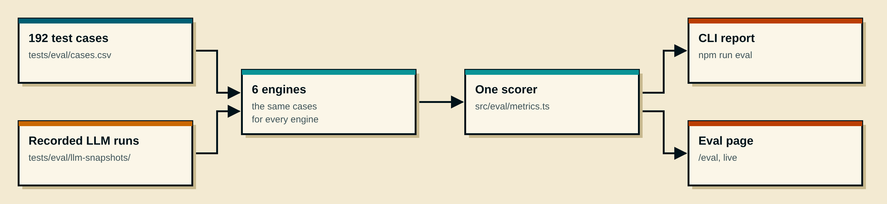
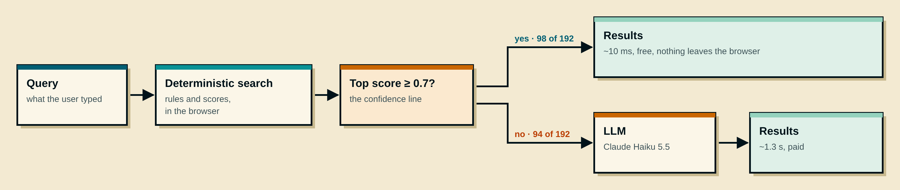

# Evaluation

How good the search is, in numbers, and whether an LLM is worth adding.

## At a glance

| Engine | Passed (of 192) | Best answer first | False positives | p50 / p95 | Cost / 1,000 queries |
| --- | --- | --- | --- | --- | --- |
| Deterministic (D) | 137 (71%) | 74% | 46% | 11 ms / 26 ms | 0 |
| Embeddings (E) | 34 (18%) | 19% | 8% | 7 ms / 11 ms | 0 |
| **Hybrid (D + E): the app without AI** | **143 (74%)** | **78%** | **46%** | **14 ms / 39 ms** | **0** |
| LLM alone: Claude Haiku 5.5, thinking off | 151 (79%) | 85% | 0% | 1.3 s / 2.1 s | 0.82 € |
| **Hybrid (D + LLM): Haiku 5.5, thinking off** | **178 (93%)** | **93%** | **0%** | **24 ms / 1.9 s** | **0.38 €** |
| Claude Code (reference) | 179 (93%) | 95% | 0% | not timed | — |

- **With an LLM as the fallback, the search goes from 74% to 93%,** with no false positives, and half the queries never leave the browser.
- **Each side covers the other's weak spot:** code for lists, numbers, syntax and names; the LLM for meaning.
- **Claude Code (reference) is an upper bound, not an engine:** answers written once by a Claude Code session with the full data and no time limit.

Run it: [live eval page](https://prof-chen.vercel.app/eval) or `npm run eval`.

## How it works

- **Same cases, same scorer**, so the numbers compare.
- **LLM runs are recorded** (results, time, tokens, cost per query), so reruns are free and reproducible. The page can also run them live.

## Where the cases come from

| Source | Cases | What |
| --- | --- | --- |
| The brief (PRD) | 9 | The examples in the exercise |
| Real user | 12 | Searches from a tester, kept where the result was wrong |
| Web patterns | 51 | How people search Pokémon online: typos, "what Pokémon is…", Pokémon GO syntax, questions, 7 prompt-injection attempts |
| Drafted with AI | 120 | Drafted with Claude from the data, one batch per category, reviewed by me |

The eval page filters by source and category.

## What a case says

| Query | Best | OK | Forbidden | Check |
| --- | --- | --- | --- | --- |
| put my opponent to sleep | Sing, Sleep Powder, Hypnosis, Lovely Kiss, Spore | Effect Spore | Insomnia, Vital Spirit, Rest | top 3 |

- **Best:** what the user wants. **OK:** acceptable. **Forbidden:** wrong, fails the case wherever it appears.
- **Check:** where the best answers must be: `first`, `top3`, `top10`, or `nothing` (noise like "hello").

## The metrics

| Metric | The question it answers | Range |
| --- | --- | --- |
| **Passed** | Is the check met, with no forbidden answer? | yes / no |
| **Hit@1** | Is the first result a best answer? | 0 or 1 |
| **MRR** | How high is the first best answer? 1 ÷ its rank | 0–1 |
| **Recall@10** | How many right answers are in the top 10? | 0–1 |
| **nDCG@10** | How good is the order of the top 10? | 0–1 |
| **False positives** | How many noise queries found something? | % |
| **p50 / p95** | Typical and slow query time | ms |
| **Cost** | Per 1,000 queries | € |

**nDCG in one line:** best = 2 points, ok = 1, lower ranks count less (÷ log₂(rank + 1)), divided by the score of a perfect order.

**Worked example:** best = A, B · ok = C · check top 3 · results: **C, A, X, B**

| Metric | Working | Result |
| --- | --- | --- |
| Passed | Only A in the top 3, 2 needed | ❌ |
| Hit@1 | C is first, only ok | 0 |
| MRR | First best at rank 2 | 0.5 |
| Recall@10 | A, B, C all in the top 10 | 1 |
| nDCG@10 | 3.12 ÷ 3.76 for a perfect order | 0.83 |

This result fails, yet found everything in a fairly good order. One number would hide that.

## Why embeddings alone score low

- **Used outside their job.** In the app they only run below 0.7. Alone, they get every query: names, typos, numbers, "not fire".
- **A sentence model can't do exact things:** no exact name, no number comparison, no negation.
- **Small and general:** MiniLM, 33 MB, not trained on Pokémon. "Sleep" is close to "Rest".
- **Short queries:** embeddings work best on full sentences.

A spare part measured on its own. Together with the deterministic search, they add 6 cases (137 → 143).

## The LLM fallback

- **The same rule as the app's embeddings fallback,** with an LLM instead.
- **49% of the queries go to the LLM,** all 13 "find nothing" cases included (10 noise + 3 injection), which is why false positives drop to 0.

### Where each side wins (passed, by category, Haiku 5.5 thinking on)

| Category | Hybrid (D + E) | LLM alone | Hybrid (D + LLM) |
| --- | --- | --- | --- |
| Identify from a description | 40% | 95% | 95% |
| Effects | 58% | 83% | 88% |
| Noise ("hello" → nothing) | 60% | 100% | 100% |
| Stats ("speed over 100") | 94% | 65% | 94% |
| Family ("evolution of pikachu") | 100% | 63% | 100% |
| Pokémon GO syntax (`@surf`) | 92% | 75% | 92% |

### Why the LLM alone fails 39 cases (Haiku 5.5, thinking on)

| Reason | Cases | Example |
| --- | --- | --- |
| Long lists, number filters | ~12 | "speed over 100": 6 of 10 |
| Order | ~9 | "fast electric": Jolteon before Electrode (130 vs 150 speed) |
| The app's conventions | 5 | `!flying` returned the flying ones |
| Empty answers | 4 | "pokemon that learn thunderbolt" |
| Direction, negation | 3 | Rest for "make it fall asleep" |
| Meaning | ~3 | "mutate" |

**An LLM reading 80k tokens in one pass doesn't enumerate, compute or sort exhaustively. Code does.** So the fallback only asks it what code can't answer.

## Models compared

All on prompt v3 (the whole dataset as catalogue, keys only), one run each.

| Model | LLM alone | Hybrid (D + LLM) | p95 (hybrid) | € / 1,000 (hybrid) |
| --- | --- | --- | --- | --- |
| Claude Haiku 5.5, thinking on | 153 | 175 | 2.4 s | 0.39 |
| **Claude Haiku 5.5, thinking off** (the app) | 151 | 178 | 1.9 s | 0.38 |
| Claude Haiku 4.5 | 137 | 163 | 1.6 s | 2.80 |
| Claude Sonnet 5.5 | 178 | 182 | 6.2 s | 4.62 |

- **Haiku 5.5, thinking off:** the best trade-off, and the app's setting. Sonnet adds a few cases for 12× the cost and 3× the wait. Haiku 4.5 is worse and 7× the price.
- **Thinking off:** no worse (alone 151 vs 153, as the fallback 178 vs 175: within run-to-run noise) and a shorter slow tail, but **the typical time stays at 1.3 s**: most of it is reading 80k tokens, not thinking.
- **Cost depends on traffic:** the 80k-token prompt is cached for 5 minutes. With sparse users, every query pays for it again: up to ~10 € per 1,000 queries for Haiku 5.5.

## How the prompt got here

| Version | Change | LLM alone | What I learned |
| --- | --- | --- | --- |
| v1 | Compact catalogue (26k tokens), a note per result | 147 | Missing data: learnsets, descriptions, height and weight |
| v2 | The whole dataset (80k tokens), keys only | **107** | Looked like a regression |
| v3 | Structured output, `max_tokens` 1024 | 153 | v2's drop was a bug: Haiku thinks first, and thinking counts against `max_tokens`. 75 answers were cut at 320 tokens and dropped |

I found the v2 bug because every recorded call keeps its tokens and stop reason, not just pass or fail.

## Keep in mind

- **These cases are development data now.** I fixed the search against them. The real test is a fresh set from new users.
- **Bias:** most expected answers were drafted with Claude, and the reference is Claude too.
- **Claude Code (reference) has no answers for the 7 injection cases** (added after it ran), 3 of which pass by being empty: it answered 176 of the 185 others correctly.
- **One run per model:** differences of a few cases are within noise.
- **11 expected answers were corrected from the data, all logged** in [tests/eval/changes.md](../tests/eval/changes.md) (one, "yellow mouse", only adds an ok answer). Other suggestions were rejected, some of which would have helped my engines (e.g. dropping Blastoise from "turtle").

---

**Previous:** [Design spec](./04-design-spec.md) · **Next:** [Write-up](./06-write-up.md) · [All steps](./00-steps.md)
